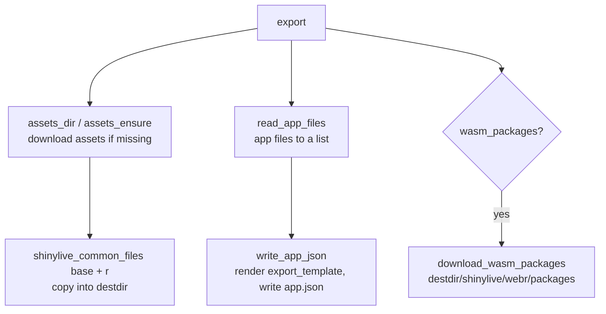

# Architecture

## What the package does

shinylive turns a Shiny for R app folder into a static website. In the
browser, [webR](https://docs.r-wasm.org/webr/latest/) runs R, and the
Shinylive web assets run the app inside a service worker. No R server is
needed.

There are four related projects. This repo is only the second one.

| Project | Role |
|---|---|
| [posit-dev/shinylive](https://github.com/posit-dev/shinylive) | The web assets (JavaScript, webR, Pyodide). Released as `shinylive-<version>.tar.gz`. |
| [posit-dev/r-shinylive](https://github.com/posit-dev/r-shinylive) | This package. Downloads the assets and exports R apps. |
| [posit-dev/py-shinylive](https://github.com/posit-dev/py-shinylive) | The Python twin. Much of this package was ported from it. |
| [quarto-ext/shinylive](https://github.com/quarto-ext/shinylive) | Quarto extension. Calls `quarto_ext()` through `Rscript` for `shinylive-r` code blocks. |

## Main flows

### `export(appdir, destdir)`

1. Pick the assets version (`assets_version()` unless `assets_version=` is
   given) and make sure that version is in the cache.
2. Copy the shared asset files into `destdir`. Files already there are not
   overwritten.
3. Read every app file into a `shinylive_file_content` list (text or binary).
4. Unless turned off, find the app's R package dependencies and download
   their Wasm binaries into `destdir/shinylive/webr/packages/`, with a
   `metadata.rds` cache.
5. Render the export template (`index.html`, `edit/index.html`) into
   `destdir/<subdir>` and write `app.json` there.

Several apps can share one `destdir` by using different `subdir` values.
They share the assets and the Wasm packages.

### `quarto_ext(args)`

The Quarto extension runs `Rscript -e 'shinylive:::quarto_ext()' extension <cmd>`
and reads JSON from stdout. Commands return asset paths as HTML dependency
objects (`info`, `base-htmldeps`, `language-resources`) or, for
`app-resources`, write the app from stdin to `.quarto/_webr/appdir`, download
its Wasm packages into `.quarto/_webr/destdir`, and list those files.
The JSON shape must match what py-shinylive prints.

### Assets cache

Assets live in `rappdirs::user_cache_dir("shinylive")`, one folder per
version: `shinylive-<version>/`. They are downloaded from the posit-dev/shinylive
GitHub release the first time a version is needed. The default version is
`SHINYLIVE_ASSETS_VERSION` in `R/version.R`; the `SHINYLIVE_ASSETS_VERSION`
environment variable overrides it. Wasm binaries must be built for the R
version of the webR inside the assets, which is read from the assets with
`assets_webr_r_version()`.

## Package structure

| File | What it holds |
|---|---|
| `R/export.R` | `export()`, the main entry point; `wasm_packages_able()`, `check_subdir()` |
| `R/app_json.R` | `read_app_files()`, `write_app_json()`; the file and app info objects |
| `R/assets.R` | Download, cache, install, and remove assets; `assets_version()`; webR R version lookup |
| `R/deps.R` | Lists asset files (`shinylive_common_files()`) and builds HTML dependency objects |
| `R/packages.R` | Finds R package dependencies and downloads their Wasm binaries; `parse_max_filesize()` |
| `R/quarto_ext.R` | `quarto_ext()` command-line interface; `build_app_resources()` |
| `R/cli.R` | `cli` wrappers that respect the `shinylive.quiet` option |
| `R/utils.R` | Argument checks, `create_copy_fn()`, `unlink_path()`, `full_path()`, `cran_is_testing()` |
| `R/version.R` | `SHINYLIVE_ASSETS_VERSION`, `SHINYLIVE_R_VERSION` |
| `R/release.R` | `release_bullets()` for `usethis::use_release_issue()` |
| `R/shinylive-package.R` | Package doc and imports (`%||%`, `is_interactive`, `deprecated`) |

Other folders:

- `tests/testthat/` - tests and test apps; see `testing.md`.
- `local/` - apps and a Quarto project for trying changes by hand. Not in the
  built package.
- `examples/` and `.github/workflows/deploy-app.yaml` - the reusable GitHub
  Actions workflow for users; see `ciAndTooling.md`.
- `revdep/` - reverse dependency check results.

## Key design points

- **Assets are not in the package.** They are hundreds of MB, so they are
  downloaded to a user cache on first use. Anything that touches assets can
  hit the network.
- **Export is additive.** Re-exporting into the same `destdir` keeps files
  that are already there, and only prints a message if an asset file differs. Wasm
  packages are cached in `metadata.rds` next to them.
- **Quiet by default when not interactive.** Progress output goes through
  the `R/cli.R` wrappers, which check `getOption("shinylive.quiet")`.
- **Plain lists with a class** (`structure(list(...), class = ...)`) are used
  for file contents, app info, and HTML dependencies. They are turned into
  JSON with `jsonlite`. There are no R6 or S4 classes.
- **Ported code.** Python docstrings and commented-out Python from
  py-shinylive are still in some files. Keep names and behavior in line with
  py-shinylive where the Quarto extension depends on them.

## Where to read next

| R file(s) | Doc |
|---|---|
| `R/export.R`, `R/app_json.R`, `R/cli.R`, `R/utils.R` | `export.md` |
| `R/assets.R`, `R/version.R` | `assets.md` |
| `R/packages.R` | `wasmPackages.md` |
| `R/quarto_ext.R`, `R/deps.R` | `quartoExtension.md` |
| `tests/testthat/` | `testing.md` |
| `.github/`, `examples/`, `R/release.R`, `DESCRIPTION`, `NEWS.md`, `_pkgdown.yml` | `ciAndTooling.md` |

## Pitfalls

- **Three version numbers.** `assets_version()` is the web assets version
  (like `0.10.16`). `SHINYLIVE_R_VERSION` is this package's version. The webR
  R version (like `4.6.0`) is a third one, read from the assets.
- **`SHINYLIVE_ASSETS_VERSION` the env var beats the constant.** A stale env
  var in your shell makes tests and exports use another assets version.
- **Most tests skip by default.** Set `TEST_ASSETS=1` (or `true`) to run the tests
  that need the assets; see `testing.md`.
- **stdout belongs to Quarto.** Inside `quarto_ext()`, only the final JSON may
  go to stdout. Use `cli` messages (stderr) for anything else.
